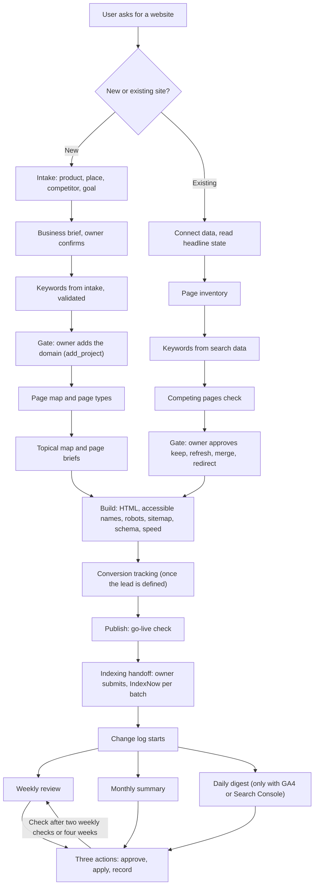

# skills

Agent skills that take a site owner who may not know SEO from "I want a website" to a live, measured site, then keep it improving.

Built for Grok Bot and any agent with the RankMySEO MCP connected.

**Status: draft.** Tool names and gates were checked against the RankMySEO MCP catalog and two read-only calls on a real account. The skills have not yet been run end to end on an agent or on a fresh customer account. See [the review](docs/skill-review-2026-10-23.md) for the sources behind each rule.

## How a user goes through it



## Skills

Start with `rankmyseo-seo-agent`. It picks the phase and sends the agent to one skill at a time.

| Skill | Phase | Use when |
| --- | --- | --- |
| `rankmyseo-seo-agent` | All | Start here. Routes to the right phase and sets the rules |
| `seo-launch-plan` | Plan | A new site, from intake to page map |
| `seo-keyword-selection` | Plan | Choosing keywords for a new site (from intake) or an existing one (from search data) |
| `seo-existing-site` | Baseline | A live site the agent has not seen: inventory, keep, refresh, merge, redirect |
| `seo-page-brief` | Build | A brief for each new page, and the owner facts that must arrive first |
| `seo-page-rewrite` | Build or maintain | An existing page needs new copy, title, or description |
| `seo-site-setup` | Build | Rendering, HTML, accessible names, robots, sitemap, schema, speed, measurement |
| `seo-conversion-tracking` | Measure | Turning the owner's lead definition into GA4 key events, without personal data |
| `seo-go-live-check` | Launch | The first month after a site first goes live |
| `seo-indexing` | Launch | A finished batch of new pages is ready to submit to Google, Bing, and IndexNow |
| `seo-reporting` | Report | The change log, and the weekly and monthly owner report |
| `seo-maintenance-loop` | Maintain | The weekly review, monthly summary, daily digest, and three actions |
| `seo-search-data` | Maintain | Reading Search Console and GA4 without over-reading them |

## What the skills need

- **RankMySEO MCP**, over `POST /mcp` with a bearer key. A guest key works for one site and two keywords for 48 hours. For the owner's plan, call `request_link` and have the owner open the link.
- **Search Console and GA4**, read either directly or through RankMySEO (`search_console` and `analytics_pages`). RankMySEO is recommended, not required. The owner connects whichever source they use.
- **The agent does the SEO work itself.** RankMySEO does not build or publish pages. The agent plans, writes, and edits pages and SEO settings in the files or builder it can reach, then checks the results. RankMySEO supplies rank tracking and history.

## Owner gates

The agent stops and waits for the owner at these points:

1. The business brief is confirmed, before a keyword plan is reported.
2. The domain is added to RankMySEO, before any keyword tool runs.
3. Keep, refresh, merge, redirect, and remove decisions are approved, before any page changes.
4. Conversion events are set up, once the owner has defined a lead.
5. The owner submits sitemaps and indexing requests in Google and Bing. IndexNow is sent per batch after a yes.
6. Every live change is approved, then recorded in the change log.

## Cadence

- **Weekly review:** one full round of the maintenance loop, ending in three actions.
- **Monthly summary:** the same loop over 28 days, compared with the 28 days before.
- **Daily digest:** only when GA4 or Search Console is connected. It reports and proposes no daily actions.
- **Rank checks:** weekly on every plan. Growth and above also get a daily pass when there is room. The agent checks `account_status` before describing a daily rank as available.

## What the agent can and cannot do

Checked on 24 October 2026 against the tools connected to this session.

| Task | Agent | Owner |
| --- | --- | --- |
| Read RankMySEO data (ranks, issues, next actions) | Yes | |
| Read Search Console and GA4 | Yes, through RankMySEO or a direct connector | Connects the source |
| Submit a sitemap or request indexing in Google Search Console | No | Yes |
| Submit a sitemap in Bing Webmaster Tools | No | Yes |
| Send an IndexNow request | Yes, one request per batch, with the owner's key. Not yet tested | Gives the key and confirms each batch |
| Connect Google Business Profile | No | Yes, only if chosen |
| Build and edit pages | Yes, in the files or builder it can reach | Reviews |
| Publish live | Only with the owner's yes | Gives the yes |

## Out of scope for this set

Social research, the Operator shop, Operator AI, and Indonesian copy by default. Add them later as their own skills.

## Layout

```text
skills/<name>/SKILL.md
```

Each `SKILL.md` has `name` and `description` in its frontmatter, then the instructions. The `name` matches the folder. Read the file in full before acting on it.

## Evidence

[`docs/skill-review-2026-10-23.md`](docs/skill-review-2026-10-23.md) records the review of two external skill repos and four rounds of checks against primary sources. It lists each factual claim, its source, whether we adopted it, and the decisions log. Nothing in the set has been tested on an agent or a live site yet.

## Assumption to confirm

The skills use the same `SKILL.md` format as the other skills in the workspace. If Grok Bot loads a different format, the body is plain markdown and can move over unchanged.
